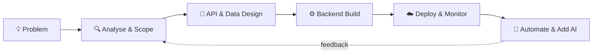

<div align="center">


<br/>

[](https://www.linkedin.com/in/vamshi-fullstack-developer/)
[](mailto:vamshiyvu@gmail.com)
[](https://github.com/B-VAMSHIDHARREDDY)

</div>

---

## 🖥️ `whoami`

```python
class Developer:
    name       = "Vamshidhar Reddy Beecharlla"
    role       = "Technical Analyst @ Stryv.ai"
    experience = "5+ years"
    based_in   = "Hyderabad, India"

    core_stack = ["Python", "FastAPI", "Django", "React", "PostgreSQL"]
    cloud      = ["AWS", "Azure", "Docker Swarm", "GitLab CI/CD"]
    currently  = ["AI agents", "LLM integrations", "workflow automation"]

    def philosophy(self):
        return "Understand the problem deeply, then build the simplest system that scales."
```

I sit where **analysis meets engineering**: breaking down complex requirements, designing the API and data layer behind them, and shipping production-ready software. I also like automating the boring parts and experimenting with AI-assisted development.

---

## 🧭 How I Build



---

## 🧰 Tech Universe

<div align="center">

**Languages**<br/>


**Backend**<br/>


**Frontend**<br/>


**Databases**<br/>


**Cloud & DevOps**<br/>


**Tools**<br/>


</div>

<details>
<summary><b>📂 Full skill breakdown (click to expand)</b></summary>

<br/>

| Category | Skills |
|---|---|
| **Backend** | Django REST Framework, SQLAlchemy, REST APIs, Microservices |
| **Databases** | PostgreSQL, Database Design, Query Optimization |
| **Cloud** | EC2, S3, RDS, CloudWatch, Azure Functions |
| **DevOps** | Docker Swarm, GitLab CI/CD, Deployment Automation |
| **Testing** | PyTest, unittest, Vitest |
| **Data** | Pandas, NumPy |
| **AI** | LLM Integration, AI Workflows, AI Agents, Prompt Engineering |
| **Integration** | Third-party APIs, Web Services, RTSP/IP Camera Integration |
| **AI Dev Tools** | Claude Code, AI-Assisted Development |

</details>

---

## 🛤️ Career Log

```text
$ git log --career --oneline
```

| | Role | Company | Period |
|:-:|---|---|---|
| 🚀 | **Technical Analyst** | Stryv.ai | 2024 – Present |
| 💻 | **Software Engineer** | SmallDay IT Services Pvt Ltd | 2021 – 2024 |
| 🌱 | **Full Stack Developer Intern** | Palle Technologies | Early career |

<details open>
<summary><b>🚀 Stryv.ai: Technical Analyst</b></summary>

<br/>

- Analysing requirements and translating them into scalable backend services with **Python & FastAPI**
- Building cloud-based applications with **Azure Functions**
- Working on **BBOS enterprise APIs** and integrations
- Optimising backend performance and data processing

</details>

<details>
<summary><b>💻 SmallDay IT Services: Software Engineer</b></summary>

<br/>

- Built **CodexPro.ai**, a coding and MCQ assessment platform
- Developed backend services and RESTful APIs
- Deployed applications using **AWS and Docker Swarm**
- Improved deployment workflows and application performance

</details>

<details>
<summary><b>🌱 Palle Technologies: Full Stack Developer Intern</b></summary>

<br/>

- Built a family expense tracking application
- Implemented backend functionality with **Django and MySQL**
- Worked on frontend and database integration

</details>

---

## 🏆 Impact in Numbers

<div align="center">

| 🚀 **70%** | ⚡ **10K+** | ☁️ **AWS** |
|:---:|:---:|:---:|
| Faster deployments<br/>with Docker Swarm | Records processed<br/>with Pandas | Logging & monitoring<br/>via CloudWatch |

</div>

---

## 🔭 Currently Exploring

<div align="center">


</div>

```yaml
loading:
  ai_saas_products:      "████████░░  80%"
  multi_agent_systems:   "██████░░░░  60%"
  scalable_backends:     "█████████░  90%"
  cloud_automation:      "███████░░░  70%"
  ai_assisted_coding:    "████████░░  80%"
```

---

## 📊 GitHub Analytics

<div align="center">


<br/><br/>


</div>

<sub>📌 Private-repo contributions only count if "Show private contributions" is enabled in your GitHub profile settings.</sub>

---

## 🤝 Let's Build Something

<div align="center">

Got an idea, a messy problem, or a project that needs structure? Let's talk.

<a href="mailto:vamshiyvu@gmail.com">

</a>
<a href="https://www.linkedin.com/in/vamshi-fullstack-developer/">

</a>

<br/><br/>

### 💡 *"Analyse first. Build smart. Scale with confidence."*


</div>
